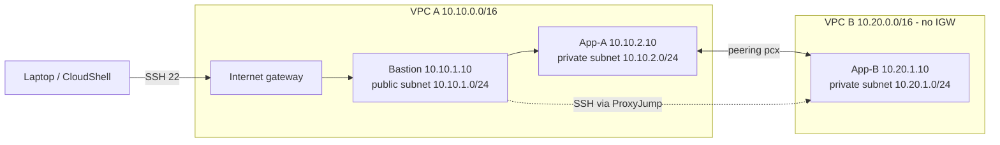

# AWS VPC Peering Lab

 

Two private AWS networks connected with **VPC peering**, administered through a public **bastion host**, and verified with positive and negative tests. Built for the EWB Courses *AWS Architect Associate* project (Project 01).

**Student:** Farhan · **Region:** Asia Pacific (Sydney) `ap-southeast-2` · **Date:** 29 Oct 2026
**Live report:** https://ehuntr.github.io/aws-vpc-peering-lab/ · **Full report:** [REPORT.md](REPORT.md)

## Architecture



## What it builds

| Resource | Name | CIDR / IP |
|---|---|---|
| VPC A | ewb-vpc-a | 10.10.0.0/16 |
| Public subnet | ewb-a-public | 10.10.1.0/24 |
| Private subnet A | ewb-a-private | 10.10.2.0/24 |
| VPC B | ewb-vpc-b | 10.20.0.0/16 |
| Private subnet B | ewb-b-private | 10.20.1.0/24 |
| Bastion / App-A / App-B | ewb-bastion / ewb-app-a / ewb-app-b | 10.10.1.10 / 10.10.2.10 / 10.20.1.10 |
| Peering | ewb-a-b-peer | A ↔ B |

### Routes

| Route table | Destination | Target |
|---|---|---|
| ewb-rt-a-public | 0.0.0.0/0 · 10.20.0.0/16 | IGW · peering |
| ewb-rt-a-private | 10.20.0.0/16 | peering |
| ewb-rt-b-private | 10.10.0.0/16 | peering (return path) |

### Security groups (inbound)

| Group | Rule | Source |
|---|---|---|
| ewb-sg-bastion | SSH 22 | my public IP /32 |
| ewb-sg-app-a | SSH 22 · ICMP echo | 10.10.1.10/32 · 10.20.1.10/32 |
| ewb-sg-app-b | SSH 22 · ICMP echo | 10.10.1.10/32 · 10.10.2.10/32 |

## How to run (AWS CloudShell)

```bash
chmod +x ewb_vpc_peering_lab.sh
export STUDENT=YourName
export AWS_REGION=ap-southeast-2
./ewb_vpc_peering_lab.sh network     # build VPCs, subnets, IGW, SGs, key, instances
./ewb_vpc_peering_lab.sh baseline    # ping fails (no peering yet)
./ewb_vpc_peering_lab.sh peer        # create + accept peering, add routes
./ewb_vpc_peering_lab.sh verify      # pings, SSH to App-B, no public IP
./ewb_vpc_peering_lab.sh failtest    # remove ICMP rule, then restore
./ewb_vpc_peering_lab.sh inventory   # IDs, routes, SG rules
./ewb_vpc_peering_lab.sh cleanup     # delete everything (avoid charges)
```

## Test results

Real output is in [`evidence/session-output.txt`](evidence/session-output.txt). Peering ID `pcx-0df06200c1eb7b74a`.

| # | Test | Expected | Result |
|---|---|---|---|
| 01 | Baseline ping App-A → App-B | No replies | ✅ 100% packet loss |
| 02 | Forward ping | 0% loss | ✅ 4/4 replies, 0% loss |
| 03 | Reverse ping | 0% loss | ✅ 4/4 replies, 0% loss |
| 04 | SSH to App-B via bastion | Shell | ✅ Shell on ip-10-20-1-10 |
| 05 | No public IP on App-A/B | None | ✅ None on both |
| 06 | Controlled ICMP failure + recovery | Fails then recovers | ✅ 0% → 100% loss → 0% |

## Key concepts

- **Return route:** replies need a route back, so both VPCs point to the peering connection.
- **Bastion source:** App-B sees the bastion's private IP because the bastion opens the SSH connection (ProxyJump).
- **Active ≠ reachable:** peering is the link; routes and security groups decide traffic.
- **No internet via peering:** VPC B cannot use VPC A's internet gateway.

## Cleanup

`./ewb_vpc_peering_lab.sh cleanup` terminates instances and deletes routes, peering, security groups, subnets, route tables, IGW, VPCs and the key pair. Tag used on every resource: `Project=EWB-VPC-Peering`.

## Security

No private keys or credentials are stored in this repo (`.gitignore` blocks `*.pem`).
