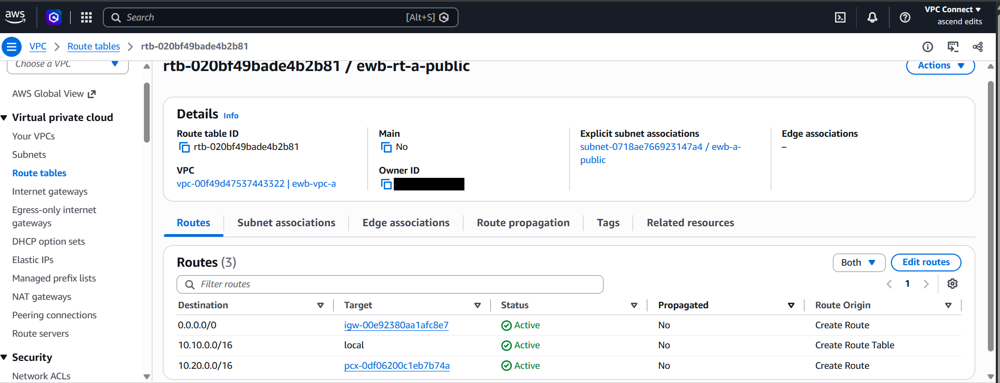
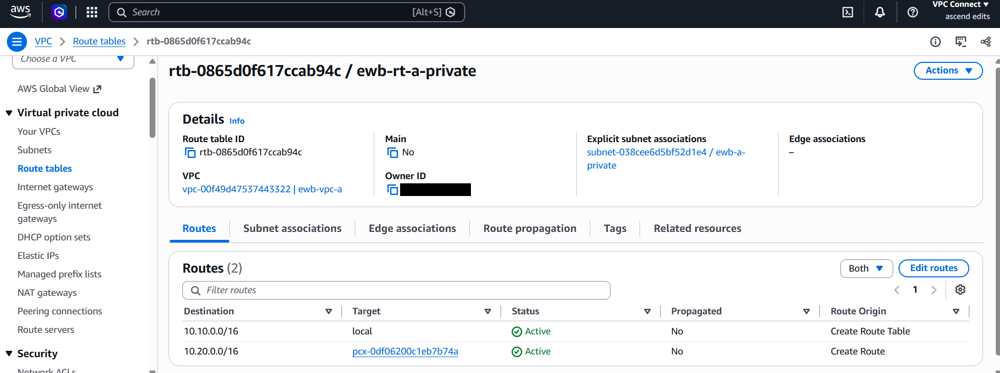
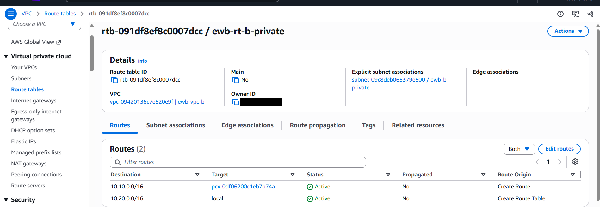
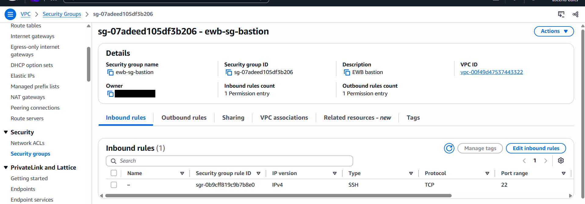
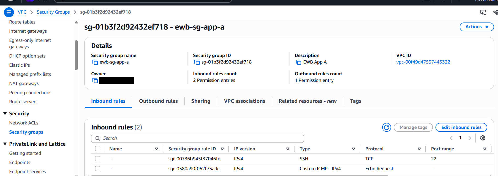
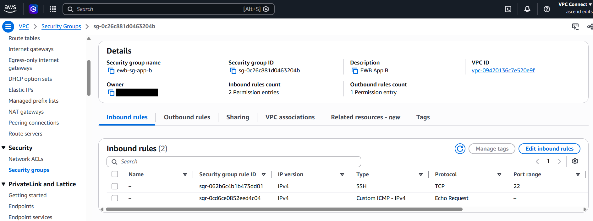

# Project Report: AWS VPC Peering

**Student:** Farhan · **Batch:** 1.1 · **Region:** Asia Pacific (Sydney) `ap-southeast-2` · **Date:** 29 Oct 2026

## 1. What I built (in simple words)

I made two separate private networks in AWS (VPC A and VPC B) and connected them with a private link called **VPC peering**. Two small servers, one in each network, can now talk to each other using private addresses, while neither has a public IP. One extra server, the **bastion**, is the only door from the internet, and I use it to log in to the private servers.

| Part | Simple meaning | In this project |
|---|---|---|
| VPC | A private network in the cloud | `ewb-vpc-a` 10.10.0.0/16, `ewb-vpc-b` 10.20.0.0/16 |
| Subnet | A section inside the network | public 10.10.1.0/24, private 10.10.2.0/24, private 10.20.1.0/24 |
| Internet gateway | The front door to the internet | `ewb-igw-a` on VPC A only |
| Route table | Signboards that say where traffic goes | 3 tables, with routes both ways |
| Peering | A private road between two VPCs | `pcx-0df06200c1eb7b74a` (Active) |
| Security group | A guard that allows only listed traffic | 3 groups, only /32 addresses |
| Bastion | A single, guarded entry server | `ewb-bastion` 10.10.1.10 |

## 2. Real-world use

- **Companies split systems into separate networks** (for example a web app network and a database or reporting network) and peer them so they stay private but can still talk.
- **Mergers and teams:** two departments or two companies with their own AWS networks can share services without using the public internet.
- **Security:** keeping servers without public IPs, entering only through a bastion, and allowing only exact addresses reduces the chance of attacks.
- **Cost and speed:** traffic stays on AWS's private network, so it is fast and avoids internet data paths.

## 3. Architecture

See the diagram in [README.md](README.md). Admin path: laptop/CloudShell → bastion → App-A or App-B (SSH ProxyJump). Project traffic: App-A ↔ App-B over private IPs through the peering connection.

## 4. Resource inventory

Full list: [evidence/inventory.txt](evidence/inventory.txt).

## 5. Routes and security rules

**Forward path:** App-A → `ewb-rt-a-private` matches 10.20.0.0/16 → peering → App-B.
**Return path:** App-B → `ewb-rt-b-private` matches 10.10.0.0/16 → peering → App-A.
**Public route table:** the bastion opens the SSH connection to App-B, so it also needs 10.20.0.0/16 → peering.

## 6. Test results (my own run, see [evidence/session-output.txt](evidence/session-output.txt))

| Test | Result |
|---|---|
| 01 Baseline ping before peering | 100% packet loss (expected) |
| 02 App-A → App-B | 4/4 replies, 0% loss |
| 03 App-B → App-A | 4/4 replies, 0% loss |
| 04 SSH to App-B via bastion | Shell reached |
| 05 No public IPv4 on App-A / App-B | `None` on both |
| 06 Controlled failure | ICMP rule removed → 100% loss; restored → 0% loss |

## 7. Explanations

1. **Why is the return route needed?** A reply has to travel back too. Without a route back, the reply is lost.
2. **Why is the App-B SSH source the bastion's private IP?** The bastion opens its own SSH connection to App-B from inside the network, so App-B sees the bastion's private address.
3. **Why doesn't Active peering guarantee a ping?** Peering is only the link. Routes on both sides and security group rules decide whether traffic passes.
4. **Can VPC B use VPC A's internet gateway over peering?** No. Peering does not pass internet access to the other VPC.

## 8. Cleanup

All lab resources were deleted and the tag check (Project = EWB-VPC-Peering) returned nothing. See [evidence/07_cleanup.txt](evidence/07_cleanup.txt).

- Instances, security groups, peering, routes, subnets, route tables, internet gateway, both VPCs and the key pair: deleted
- Result: no remaining resources, so no further charges

## 9. What I learned

This project taught me how to keep private data safe in the cloud. Important servers stay private, and people can reach them only through one guarded entry point. This shows the cloud can be secure when it is set up properly.

The hardest part for me was understanding public and private networks and how to connect the two VPCs. I used Claude's help to finish this project and to understand each step. Now I can explain why the routes, security groups and peering are needed.

---
Account IDs are hidden in the screenshots. No keys or passwords are included in this repository.
